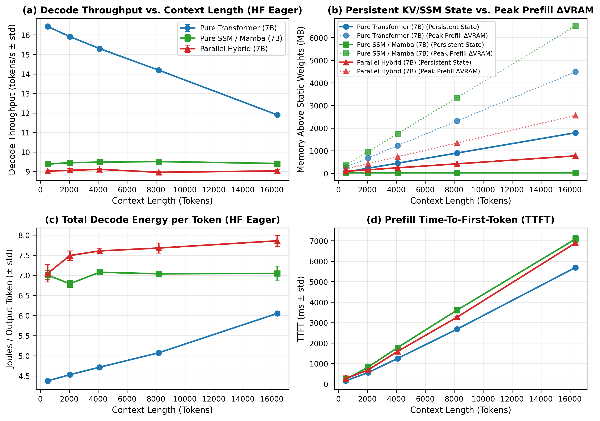
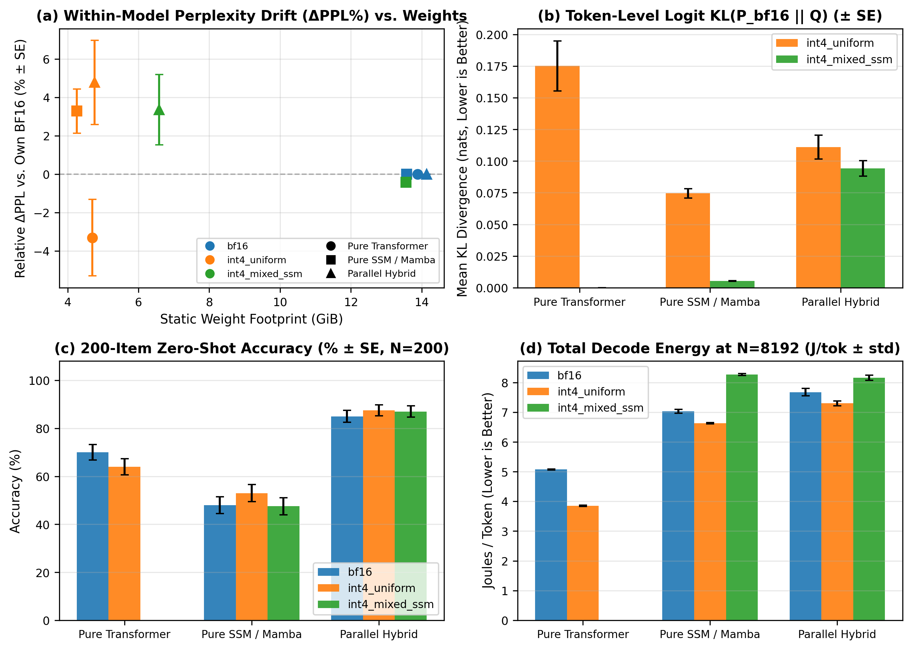
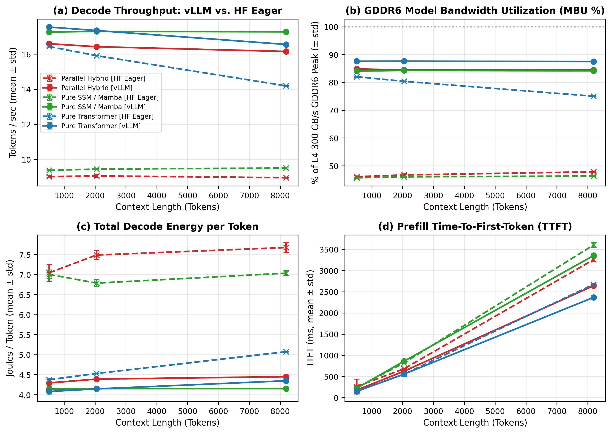

# Falcon 7B Architecture Crossover, Branch-Aware Quantization & vLLM Energy/MBU Telemetry

[](https://modal.com)
[](https://huggingface.co/tiiuae)
[](#4-open-source-vllm-energy--roofline-mfumbu-profiler)
[](https://orcid.org/0009-0008-2204-7324)
[](https://orcid.org/0009-0008-2204-7324)
[](https://scholar.google.co.uk/citations?user=D0ZI6BoAAAAJ)
[](https://opensource.org/licenses/Apache-2.0)

**Author:** **Harith Ibrahim** ([ORCID: `0009-0008-2204-7324`](https://orcid.org/0009-0008-2204-7324) • [Google Scholar Profile](https://scholar.google.co.uk/citations?user=D0ZI6BoAAAAJ) • [GitHub Profile (@HarithSami)](https://github.com/HarithSami))  
**Dataset Card:** [`results/DATASET_CARD.md`](results/DATASET_CARD.md) • **Single Source of Truth:** [`results/RESULTS.md`](results/RESULTS.md)

An empirical hardware-efficiency, post-training quantization, and serving-engine study across the **Technology Innovation Institute's (TII) 7B architectural triad**:
1. **Pure Transformer (GQA):** [`tiiuae/Falcon3-7B-Instruct`](https://huggingface.co/tiiuae/Falcon3-7B-Instruct) (28 layers)
2. **Pure State-Space Model (SSM / Mamba-1):** [`tiiuae/Falcon3-Mamba-7B-Instruct`](https://huggingface.co/tiiuae/Falcon3-Mamba-7B-Instruct) (64 mixer layers)
3. **Parallel Hybrid (Mamba-2 + Attention):** [`tiiuae/Falcon-H1-7B-Instruct`](https://huggingface.co/tiiuae/Falcon-H1-7B-Instruct) (44 parallel hybrid layers)

All benchmarks were executed on isolated **NVIDIA L4 (24 GB GDDR6, 300 GB/s peak bandwidth, 72 W TDP)** datacenter GPUs using 50 Hz NVML hardware energy integration (`pynvml`) and cumulative energy counter telemetry informed by **IEEE P1959/P1960** working-group discussions. All reported values represent $n=5$ independent trial runs (mean $\pm$ sample std / SE).

---

## Executive Summary: Supported Headline Findings

1. **In HF Eager, Falcon3-7B Is Fastest at All Contexts (SSM/Hybrid Gap Is Mostly Launch Overhead):**  
   Under Hugging Face eager execution, `Falcon3-7B` achieves higher decode throughput ($16.43 \rightarrow 11.90\text{ tok/s}$) and lower energy per token ($4.38 \rightarrow 6.05\text{ J/tok}$) than both SSM-based models across all measured sequence lengths from 512 to 16K. While `Falcon3-7B` decode slows by $27.6\%$ due to linear KV cache expansion, Mamba ($9.38 \rightarrow 9.41\text{ tok/s}$) and H1 ($9.02 \rightarrow 9.03\text{ tok/s}$) throughput is flat within $\sim 1\%$. The eager deficit of Mamba/H1 is dominated by sequential framework/kernel launch overhead across 44–64 layers rather than inherent architecture inefficiency.
2. **vLLM CUDA Graphs Unlock 1.8–1.9× Decode Speedup for Mamba & H1; Falcon3-Mamba-7B Leads at 8K:**  
   Amortizing kernel launch overhead via CUDA graph capture in `vLLM` v1 yields a **$1.8\text{--}1.9\times$ decode speedup** for `Falcon3-Mamba-7B` ($9.38 \rightarrow 17.26\text{ tok/s}$ at 512; $9.51 \rightarrow 17.27\text{ tok/s}$ at 8K) and `Falcon-H1-7B` ($9.02 \rightarrow 16.59\text{ tok/s}$ at 512; $8.96 \rightarrow 16.15\text{ tok/s}$ at 8K), compared to $1.07\text{--}1.17\times$ for `Falcon3-7B` ($16.43 \rightarrow 17.54\text{ tok/s}$ at 512; $14.19 \rightarrow 16.55\text{ tok/s}$ at 8K), cutting total energy per token by $\sim 41\%$ (Mamba) and $\sim 39\text{--}42\%$ (H1). Under vLLM at 8K context, **`Falcon3-Mamba-7B` is the fastest and most energy-efficient model** ($17.27 \pm 0.01\text{ tok/s}$, $4.152\text{ J/tok}$), leading `Falcon3-7B` ($16.55 \pm 0.02\text{ tok/s}$, $4.348\text{ J/tok}$) by $4.4\%$ in speed and $4.5\%$ in energy. `Falcon-H1-7B` trails `Falcon3-7B` by $\sim 2.4\%$ at 8K ($16.15 \pm 0.05\text{ tok/s}$, $4.450\text{ J/tok}$).
3. **KV/SSM Persistent State Scaling & Peak VRAM Near-Parity Around 2K:**  
   Analytical persistent state scales linearly for `Falcon3-7B` from $56\text{ MB}$ at 512 to **$1,792\text{ MB}$** at 16K. In contrast, `Falcon-H1-7B` reduced KV + Mamba state reaches only **$771\text{ MB}$** at 16K ($2.3\times$ smaller), while `Falcon3-Mamba-7B` recurrent state remains strictly constant at **$20\text{ MB}$**. Total peak VRAM reaches **near-parity around 2K context** ($14,900.5\text{ MB}$ for Falcon3 vs. $14,902.9\text{ MB}$ for H1, a $2.4\text{ MB}$ difference), and at 16K H1 peak VRAM is $1,671\text{ MB}$ lower ($17,038.4\text{ MB}$ vs. $18,709.2\text{ MB}$). Pure Mamba peak VRAM grows to $20,412.4\text{ MB}$ at 16K due to transient prefill workspace in PyTorch eager mode.
4. **Quantization: Coarse Probe Retains Accuracy; Branch-Aware Trade-Offs on H1:**  
   Across all three models, 4-bit NormalFloat quantization causes no detectable accuracy breakdown on the 200-item evaluation probe (probe accuracy shifts remain within $\sim 1\text{--}1.5\text{ SE}$). On `Falcon-H1-7B`, branch-aware mixed precision (`int4_mixed_ssm`) keeps Mamba projections in native BF16 and quantizes Attention/MLP to NF4, compressing static weights by **$-53.4\%$** ($14.48 \rightarrow 6.74\text{ GB}$). Compared to uniform NF4 ($4.87\text{ GB}$), it yields modestly lower token-level KL divergence ($0.094 \pm 0.006$ vs. $0.111 \pm 0.009$; $\sim 1.5$ combined SE) and lower $\Delta\text{PPL}$ ($+3.36\%$ vs. $+4.78\%$), but is slower and less energy-efficient under eager bitsandbytes at 8K ($6.64\text{ tok/s}$, $8.162\text{ J/tok}$ vs. $6.66\text{ tok/s}$, $7.301\text{ J/tok}$). In bitsandbytes, NF4 slows SSM decode while accelerating `Falcon3-7B` ($14.19 \rightarrow 18.58\text{ tok/s}$). Mixed precision on pure Mamba quantizes almost nothing ($13,880.7$ vs. $13,896.7\text{ MB}$) and serves as a positive control confirming skip-list functionality ($\text{KL} = 0.005$).

---

## 1. 7B Architecture Crossover (HF Eager BF16, Context 512 to 16,384)



*Figure 1: 2x2 publication grid showing (a) decode throughput vs. context length in HF eager, (b) persistent state vs. peak prefill $\Delta$VRAM, (c) total decode energy per token, and (d) prefill TTFT on NVIDIA L4 (24 GB GDDR6).*

All measurements represent $n=5$ independent trials (mean $\pm$ sample std). Static model weights: `Falcon3-7B` 14,220.4 MB, `Falcon3-Mamba-7B` 13,896.7 MB, `Falcon-H1-7B` 14,477.3 MB.

| Architecture (`model_id`) | Context | TTFT (ms) | Decode (`tok/s`) | Persist. State MB (analytical) | Peak VRAM (MB) | Total Energy (`J/tok`) |
| :--- | ---: | ---: | ---: | ---: | ---: | ---: |
| **Pure Transformer (7B)** (`Falcon3-7B`) | 512 | 153.5±7.0 | 16.43±0.03 | 56 | 14492.4 | 4.376±0.034 |
| **Pure Transformer (7B)** (`Falcon3-7B`) | 2048 | 552.0±6.2 | 15.91±0.02 | 224 | 14900.5 | 4.529±0.011 |
| **Pure Transformer (7B)** (`Falcon3-7B`) | 4096 | 1247.5±7.8 | 15.30±0.01 | 448 | 15444.6 | 4.714±0.015 |
| **Pure Transformer (7B)** (`Falcon3-7B`) | 8192 | 2674.1±23.1 | 14.19±0.03 | 896 | 16532.8 | 5.074±0.012 |
| **Pure Transformer (7B)** (`Falcon3-7B`) | 16384 | 5695.5±20.5 | 11.90±0.04 | 1792 | 18709.2 | 6.052±0.027 |
| **Pure SSM / Mamba (7B)** (`Falcon3-Mamba-7B`) | 512 | 225.0±5.2 | 9.38±0.03 | 20 | 14258.4 | 7.005±0.110 |
| **Pure SSM / Mamba (7B)** (`Falcon3-Mamba-7B`) | 2048 | 819.9±8.6 | 9.45±0.04 | 20 | 14853.9 | 6.788±0.084 |
| **Pure SSM / Mamba (7B)** (`Falcon3-Mamba-7B`) | 4096 | 1779.7±3.6 | 9.48±0.02 | 20 | 15648.0 | 7.075±0.045 |
| **Pure SSM / Mamba (7B)** (`Falcon3-Mamba-7B`) | 8192 | 3605.4±56.5 | 9.51±0.06 | 20 | 17236.1 | 7.035±0.063 |
| **Pure SSM / Mamba (7B)** (`Falcon3-Mamba-7B`) | 16384 | 7089.0±179.8 | 9.41±0.08 | 20 | 20412.4 | 7.045±0.185 |
| **Parallel Hybrid (7B)** (`Falcon-H1-7B`) | 512 | 258.2±175.4 | 9.02±0.05 | 89 | 14674.1 | 7.044±0.213 |
| **Parallel Hybrid (7B)** (`Falcon-H1-7B`) | 2048 | 680.4±12.5 | 9.06±0.08 | 155 | 14902.9 | 7.489±0.115 |
| **Parallel Hybrid (7B)** (`Falcon-H1-7B`) | 4096 | 1593.0±101.3 | 9.11±0.05 | 243 | 15208.0 | 7.604±0.053 |
| **Parallel Hybrid (7B)** (`Falcon-H1-7B`) | 8192 | 3259.3±46.1 | 8.96±0.03 | 419 | 15818.1 | 7.676±0.124 |
| **Parallel Hybrid (7B)** (`Falcon-H1-7B`) | 16384 | 6892.5±73.0 | 9.03±0.07 | 771 | 17038.4 | 7.855±0.138 |

### Key Observations
- `Falcon3-7B` eager decode degrades by $27.6\%$ ($16.43 \rightarrow 11.90\text{ tok/s}$) and total energy per token increases by $38.3\%$ ($4.38 \rightarrow 6.05\text{ J/tok}$) as context expands from 512 to 16K. In contrast, `Falcon3-Mamba-7B` and `Falcon-H1-7B` decode throughput is flat within $\sim 1\%$ across the entire range.
- In HF eager execution, `Falcon3-7B` is faster and more energy-efficient than both SSM models at every context up to 16K. This gap reflects Python and framework launch latency across 44–64 layers (see Section 3).
- Persistent state at 16K reaches 1,792 MB for `Falcon3-7B`, 771 MB for `Falcon-H1-7B` ($2.3\times$ reduction), and 20 MB for `Falcon3-Mamba-7B`.
- Total peak VRAM exhibits near-parity around 2K context ($14,900.5\text{ MB}$ vs. $14,902.9\text{ MB}$, a 2.4 MB difference). At 16K context, `Falcon-H1-7B` peak VRAM is 1,671 MB lower than `Falcon3-7B`. Pure Mamba peak VRAM reaches 20,412.4 MB at 16K due to transient prefill workspace allocations in the HF execution path.

---

## 2. Branch-Aware Quantization Ablation (`bf16` vs. `int4_uniform` vs. `int4_mixed_ssm`)



*Figure 2: 2x2 publication grid showing (a) relative $\Delta$PPL% vs. static weight footprint, (b) token-level logit $\text{KL}(P_{\text{bf16}} \parallel Q)$, (c) 200-item zero-shot probe accuracy, and (d) total decode energy per token at 8K context.*

Latency and energy metrics represent $n=5$ trials at 8K context (TTFT at 2K). Quality metrics are context-independent. Standard errors: SE for $\Delta$PPL is passage-level ($n=6$ passages); SE for KL is token-level; SE for probe accuracy is binomial ($N=200$ items).

| Architecture (`model_id`) | Precision | Weights (MB) | $\Delta$PPL % ±SE | KL ±SE | Top-1 % | Probe Acc % ±SE | Decode @ 8K (`tok/s`) | Energy @ 8K (`J/tok`) | Peak VRAM @ 8K (MB) | TTFT @ 2K (ms) |
| :--- | :--- | ---: | ---: | ---: | ---: | ---: | ---: | ---: | ---: | ---: |
| **Pure Transformer (7B)** (`Falcon3-7B`) | `bf16` | 14220.4 | 0 | 0 | 100 | 70.0±3.2 | 14.19±0.03 | 5.074±0.012 | 16532.8 | 552.0 |
| **Pure Transformer (7B)** (`Falcon3-7B`) | `int4_uniform` | 4808.4 | −3.31±1.99 | 0.175±0.020 | 83.0 | 64.0±3.4 | 18.58±0.09 | 3.851±0.021 | 7120.8 | 634.1 |
| **Pure SSM / Mamba (7B)** (`Falcon3-Mamba-7B`) | `bf16` | 13896.7 | 0 | 0 | 100 | 48.0±3.5 | 9.51±0.06 | 7.035±0.063 | 17236.1 | 819.9 |
| **Pure SSM / Mamba (7B)** (`Falcon3-Mamba-7B`) | `int4_uniform` | 4359.0 | +3.29±1.15 | 0.074±0.004 | 88.5 | 53.0±3.5 | 7.29±0.02 | 6.635±0.021 | 7698.5 | 916.0 |
| **Pure SSM / Mamba (7B)** (`Falcon3-Mamba-7B`) | `int4_mixed_ssm` | 13880.7 | −0.43±0.20 | 0.005±0.0002 | 97.3 | 47.5±3.5 | 7.12±0.03 | 8.271±0.035 | 17220.1 | 838.5 |
| **Parallel Hybrid (7B)** (`Falcon-H1-7B`) | `bf16` | 14477.3 | 0 | 0 | 100 | 85.0±2.5 | 8.96±0.03 | 7.676±0.124 | 15818.1 | 680.4 |
| **Parallel Hybrid (7B)** (`Falcon-H1-7B`) | `int4_uniform` | 4874.2 | +4.78±2.19 | 0.111±0.009 | 84.8 | 87.5±2.3 | 6.66±0.02 | 7.301±0.080 | 6215.0 | 736.4 |
| **Parallel Hybrid (7B)** (`Falcon-H1-7B`) | `int4_mixed_ssm` | 6739.7 | +3.36±1.83 | 0.094±0.006 | 86.0 | 87.0±2.4 | 6.64±0.05 | 8.162±0.086 | 8080.5 | 735.1 |

### Key Observations
- **No Catastrophic Breakdown:** Probe accuracy differences across precision configurations remain within $\sim 1\text{--}1.5\text{ SE}$ for every model (`Falcon3-Mamba-7B`: $48.0\% \rightarrow 53.0\% \rightarrow 47.5\%$; `Falcon-H1-7B`: $85.0\% \rightarrow 87.5\% \rightarrow 87.0\%$).
- **Control on Pure Mamba:** `int4_mixed_ssm` on pure Mamba quantizes almost no parameters ($13,880.7$ vs. $13,896.7\text{ MB}$), as Mamba has no non-recurrent attention/MLP layers. It acts as a control confirming that skipping `mamba` protects the SSM path ($\text{KL} = 0.005$).
- **Trade-Offs on Parallel Hybrid (H1):** On `Falcon-H1-7B`, `int4_mixed_ssm` keeps Mamba projections in native BF16 and quantizes Attention/MLP projections to NF4, compressing weights from 14.48 GB to 6.74 GB ($-53.4\%$). Compared to uniform NF4, it achieves modestly lower KL divergence ($0.094 \pm 0.006$ vs. $0.111 \pm 0.009$; difference $\approx 1.5$ combined SE—suggestive, not conclusive) and lower $\Delta$PPL ($+3.36\%$ vs. $+4.78\%$, overlapping SE). However, it requires 1.87 GB more memory than uniform NF4 and is slower-or-equal and less energy-efficient at 8K context ($8.162$ vs. $7.301\text{ J/tok}$). TTFT is identical at 2K and 8K ($735.1$ vs. $736.4\text{ ms}$ at 2K).
- **VRAM Footprint:** Peak VRAM for `Falcon-H1-7B` `int4_mixed_ssm` reaches 8,080.5 MB at 8K context and 7,001 MB at 512 context, exceeding 8 GB on standard PyTorch allocators.
- **bitsandbytes Kernel Overhead:** In eager bitsandbytes, NF4 dequantization slows SSM decode throughput (`Falcon-H1-7B`: $8.96 \rightarrow 6.64\text{--}6.66\text{ tok/s}$; `Falcon3-Mamba-7B`: $9.51 \rightarrow 7.12\text{--}7.29\text{ tok/s}$) while accelerating `Falcon3-7B` ($14.19 \rightarrow 18.58\text{ tok/s}$, a $+30.9\%$ throughput boost and $-24\%$ reduction in total J/tok).
- **Corpus Sensitivity:** `Falcon3-7B` `int4_uniform` $\Delta$PPL is negative ($-3.31 \pm 1.99\%$), an artifact of the small 6-passage corpus; token-level KL divergence ($0.175$) provides the more reliable fidelity signal.

---

## 3. vLLM (CUDA Graphs) vs. HF Eager: Roofline MFU/MBU & Energy



*Figure 3: 2x2 publication grid showing (a) decode throughput comparison between vLLM CUDA graphs and HF eager, (b) analytical GDDR6 Model Bandwidth Utilization (MBU %), (c) total decode energy per token, and (d) prefill TTFT on NVIDIA L4 (24 GB GDDR6).*

All measurements represent $n=5$ independent trials (mean $\pm$ sample std). Batch size 1, greedy decoding, 128 decode tokens. MFU is $0.18\text{--}0.22\%$ across all configurations, as batch-1 decode is strictly memory-bandwidth bound.

| Architecture (`model_id`) | Context | Engine | TTFT (ms) | Decode (`tok/s`) | Total Energy (`J/tok`) | MBU % (analytical) |
| :--- | ---: | :--- | ---: | ---: | ---: | ---: |
| **Pure Transformer (7B)** (`Falcon3-7B`) | 512 | `hf_eager` | 153.5±7.0 | 16.43±0.03 | 4.376±0.034 | 82.0 |
| **Pure Transformer (7B)** (`Falcon3-7B`) | 512 | `vllm` | 146.8±4.8 | 17.54±0.02 | 4.079±0.063 | 87.6 |
| **Pure Transformer (7B)** (`Falcon3-7B`) | 2048 | `hf_eager` | 552.0±6.2 | 15.91±0.02 | 4.529±0.011 | 80.4 |
| **Pure Transformer (7B)** (`Falcon3-7B`) | 2048 | `vllm` | 554.4±6.1 | 17.34±0.02 | 4.145±0.017 | 87.6 |
| **Pure Transformer (7B)** (`Falcon3-7B`) | 8192 | `hf_eager` | 2674.1±23.1 | 14.19±0.03 | 5.074±0.012 | 75.0 |
| **Pure Transformer (7B)** (`Falcon3-7B`) | 8192 | `vllm` | 2367.3±26.9 | 16.55±0.02 | 4.348±0.011 | 87.5 |
| **Pure SSM / Mamba (7B)** (`Falcon3-Mamba-7B`) | 512 | `hf_eager` | 225.0±5.2 | 9.38±0.03 | 7.005±0.110 | 45.7 |
| **Pure SSM / Mamba (7B)** (`Falcon3-Mamba-7B`) | 512 | `vllm` | 221.9±6.5 | 17.26±0.04 | 4.140±0.062 | 84.1 |
| **Pure SSM / Mamba (7B)** (`Falcon3-Mamba-7B`) | 2048 | `hf_eager` | 819.9±8.6 | 9.45±0.04 | 6.788±0.084 | 46.0 |
| **Pure SSM / Mamba (7B)** (`Falcon3-Mamba-7B`) | 2048 | `vllm` | 859.9±11.7 | 17.29±0.01 | 4.152±0.012 | 84.3 |
| **Pure SSM / Mamba (7B)** (`Falcon3-Mamba-7B`) | 8192 | `hf_eager` | 3605.4±56.5 | 9.51±0.06 | 7.035±0.063 | 46.3 |
| **Pure SSM / Mamba (7B)** (`Falcon3-Mamba-7B`) | 8192 | `vllm` | 3354.2±15.0 | 17.27±0.01 | 4.152±0.012 | 84.2 |
| **Parallel Hybrid (7B)** (`Falcon-H1-7B`) | 512 | `hf_eager` | 258.2±175.4 | 9.02±0.05 | 7.044±0.213 | 46.1 |
| **Parallel Hybrid (7B)** (`Falcon-H1-7B`) | 512 | `vllm` | 176.2±9.7 | 16.59±0.02 | 4.294±0.089 | 84.8 |
| **Parallel Hybrid (7B)** (`Falcon-H1-7B`) | 2048 | `hf_eager` | 680.4±12.5 | 9.06±0.08 | 7.489±0.115 | 46.7 |
| **Parallel Hybrid (7B)** (`Falcon-H1-7B`) | 2048 | `vllm` | 623.0±6.8 | 16.42±0.03 | 4.390±0.010 | 84.4 |
| **Parallel Hybrid (7B)** (`Falcon-H1-7B`) | 8192 | `hf_eager` | 3259.3±46.1 | 8.96±0.03 | 7.676±0.124 | 47.9 |
| **Parallel Hybrid (7B)** (`Falcon-H1-7B`) | 8192 | `vllm` | 2643.0±8.9 | 16.15±0.05 | 4.450±0.019 | 84.5 |

### Key Observations
- **CUDA Graph Amortization:** vLLM CUDA graphs speed up decode throughput by **$1.8\text{--}1.9\times$** for Mamba ($9.38 \rightarrow 17.26\text{ tok/s}$ at 512; $9.51 \rightarrow 17.27\text{ tok/s}$ at 8K) and H1 ($9.02 \rightarrow 16.59\text{ tok/s}$ at 512; $8.96 \rightarrow 16.15\text{ tok/s}$ at 8K), compared to $1.07\text{--}1.17\times$ for Falcon3-7B, cutting total energy per token by $\sim 41\%$ (Mamba) and $\sim 39\text{--}42\%$ (H1).
- **vLLM 8K Crossover:** Under vLLM at 8K context, **`Falcon3-Mamba-7B` is the fastest and most efficient model** ($17.27 \pm 0.01\text{ tok/s}$, $4.152\text{ J/tok}$), leading `Falcon3-7B` ($16.55 \pm 0.02\text{ tok/s}$, $4.348\text{ J/tok}$) by $4.4\%$ in speed and $4.5\%$ in energy. **`Falcon-H1-7B` does not overtake `Falcon3-7B`** at 8K ($16.15 \pm 0.05$ vs. $16.55 \pm 0.02\text{ tok/s}$), trailing by $\sim 2.4\%$.
- **Analytical Model Bandwidth Utilization (MBU %):** Under vLLM, analytical MBU reaches $\sim 87.5\%$ for `Falcon3-7B`, $\sim 84.2\%$ for `Falcon3-Mamba-7B`, and $\sim 84.5\%$ for `Falcon-H1-7B`, compared to $\sim 46\%$ for eager SSM execution.
- **Serving Configuration Requirements:** Default `max_num_seqs=256` in vLLM v1 pre-allocates recurrent state blocks for 256 concurrent sequences, exceeding available memory on a 24 GB GPU for both SSM models. Setting `max_num_seqs=8` (and `gpu_memory_utilization=0.92`) resolves this. Furthermore, FlashInfer JIT compilation passes `--compress-mode=size` (a CUDA 12.8+ flag) which fails on CUDA 12.4; setting `VLLM_USE_FLASHINFER_SAMPLER=0` provides stable execution.

---

## 4. Open-Source vLLM Energy & Roofline MFU/MBU Profiler

[`src/vllm_energy_mfu_profiler.py`](src/vllm_energy_mfu_profiler.py) is a standalone NVML telemetry and Roofline efficiency profiler for **Transformer, Mamba/SSM, and Parallel Hybrid (`Falcon-H1`)** models in `vLLM` or PyTorch.

### Quickstart Usage

```python
from transformers import AutoConfig
from vllm import LLM, SamplingParams
from src.vllm_energy_mfu_profiler import VLLMEnergyMFUProfiler, build_architecture_profile

model_id = "tiiuae/Falcon-H1-7B-Instruct"
hf_config = AutoConfig.from_pretrained(model_id, trust_remote_code=True)
weights_bytes = int(14477.3 * (1024**2))

profiler = VLLMEnergyMFUProfiler(device_index=0, poll_interval_s=0.02)
profiler.calibrate_idle_floor(duration_s=2.0)

arch_profile = build_architecture_profile(model_id, hf_config, weights_bytes, precision="bf16")

llm = LLM(
    model=model_id,
    trust_remote_code=True,
    dtype="bfloat16",
    max_num_seqs=8,              # Prevents 256-block Mamba state OOM on 24GB GPUs
    gpu_memory_utilization=0.92,
)

with profiler.profile_generation(
    arch=arch_profile,
    weights_vram_bytes=weights_bytes,
    engine="vllm_cudagraph",
    precision="bf16",
    context_length=8192,
    decode_tokens=128,
) as session:
    _ = llm.generate(["Your prompt here..."], SamplingParams(temperature=0.0, max_tokens=128))

print(session.report.to_dict())
```

---

## 5. Scope & Limitations

1. **Templated Evaluation Probe:** The 200-item multiple-choice probe spans 4 domains $\times$ 50 items. In the systems and Arabic/UAE domains, 5 unique questions are rotated across 10 answer permutations. The probe provides a coarse functional sanity check to verify that models did not collapse post-quantization; it is not a substitute for comprehensive academic benchmarks (e.g., MMLU, GSM8K). Reported binomial SE values overstate item independence.
2. **Analytical MBU Model:** Model Bandwidth Utilization is calculated analytically from model weights and sequence-dependent persistent state divided by peak hardware GDDR6 bandwidth (300 GB/s). It does not read hardware performance counters and omits activation, logit, and intermediate memory traffic.
3. **Container Idle Floor Variation:** Datacenter container pre-load idle power varied across serverless instances from 13.5 W to 35.4 W (and post-load idle reached 36.1 W to 43.6 W). Total J/tok is the primary metric; dynamic J/tok is reported as secondary.
4. **Batch Size Scope:** All measurements were conducted at batch size 1 (single-stream low-latency decode). Multi-sequence batching dynamics were not evaluated in the crossover sweep.

---

## 6. Reproducibility & Modal Execution

### Software & Hardware Environment
- **Hardware:** Isolated NVIDIA L4 GPU, 24 GB GDDR6, 300 GB/s bandwidth, 72 W TDP.
- **NVIDIA Driver:** `610.57.04` • **CUDA:** `12.4`
- **Core Libraries:** `torch==2.5.1+cu124`, `transformers==4.57.6`, `mamba_ssm==2.3.1`, `causal_conv1d==1.7.0`, `flash_attn==2.8.3.post2`, `bitsandbytes==0.50.2`, `vllm==0.32.0` (vLLM v1).

### Model Revision Hashes
- `tiiuae/Falcon3-7B-Instruct`: `1e57a0ecd176c7c139f289c60a74e57f887c3dfb`
- `tiiuae/Falcon3-Mamba-7B-Instruct`: `79268d5c8e650ec0ec24aad2729bfc906f569580`
- `tiiuae/Falcon-H1-7B-Instruct`: `41e72f27effbab80cd45b6e884688452253a3686`

### Reproducing on Modal Serverless GPUs

```bash
# Set up environment and credentials
pip install -r requirements.txt
modal secret create huggingface-secret HF_TOKEN=$HF_TOKEN

# 1. 1B / 1.5B Smoke Test (validating fused kernels and precision baselines)
python src/run_modal_cli.py run src/modal_benchmark.py --mode smoke

# 2. 7B 3-Architecture BF16 Crossover (512 to 16,384 context length)
python src/run_modal_cli.py run src/modal_benchmark.py --mode crossover

# 3. 7B Branch-Aware Quantization Ablation (bf16 vs. int4_uniform vs. int4_mixed_ssm)
python src/run_modal_cli.py run src/modal_benchmark.py --mode quant-ablation

# 4. 7B vLLM CUDA-Graph vs. HF Eager Roofline MFU/MBU Benchmark
python src/run_modal_cli.py run src/modal_vllm_benchmark.py

# 5. Recompute Analytical Roofline Data
python src/recompute_hf_roofline.py

# 6. Regenerate 2x2 Publication Plots
python src/plot_results.py results/benchmark_crossover.json
python src/plot_results.py results/benchmark_quant-ablation.json
python src/plot_results.py results/benchmark_vllm_mfu.json
```

---

## 7. Repository Structure

```text
├── CITATION.cff                             # Citation metadata
├── LICENSE                                  # Apache 2.0 License
├── README.md                                # Public repository documentation
├── pyproject.toml                           # Package configuration and dependencies
├── requirements.txt                         # Python runtime dependencies
├── research_findings_log.md                 # Living engineering notebook and v2 change summary
├── paper/
│   ├── falcon_7b_hybrid_crossover_paper.pdf # Compiled technical paper
│   └── falcon_7b_hybrid_crossover_paper.tex # LaTeX source code
├── results/
│   ├── DATASET_CARD.md                      # Hugging Face dataset documentation
│   ├── RESULTS.md                           # Single source of truth (v2 5-trial consolidated numbers)
│   ├── benchmark_smoke.json                 # 1B/1.5B initial validation benchmark
│   ├── benchmark_crossover.json             # 7B BF16 crossover sweep (512 to 16K, n=5)
│   ├── benchmark_quant-ablation.json        # 7B quantization ablation benchmark (n=5)
│   ├── benchmark_vllm_mfu.json              # 7B vLLM vs HF eager roofline benchmark (n=5)
│   ├── raw_50hz_crossover_traces.json       # 50 Hz power telemetry traces for crossover runs
│   ├── raw_50hz_quant-ablation_traces.json  # 50 Hz power telemetry traces for quant ablation
│   ├── raw_50hz_vllm_traces.json            # 50 Hz power telemetry traces for vLLM runs
│   └── plots/
│       ├── benchmark_crossover_charts.png   # 2x2 crossover figure (PNG)
│       ├── benchmark_crossover_charts.pdf   # 2x2 crossover figure (Vector PDF)
│       ├── benchmark_quant-ablation_charts.png # 2x2 quant ablation figure (PNG)
│       ├── benchmark_quant-ablation_charts.pdf # 2x2 quant ablation figure (Vector PDF)
│       ├── benchmark_vllm_mfu_charts.png    # 2x2 vLLM roofline figure (PNG)
│       ├── benchmark_vllm_mfu_charts.pdf    # 2x2 vLLM roofline figure (Vector PDF)
│       └── benchmark_smoke_charts.png       # 1B/1.5B smoke figure
└── src/
    ├── modal_benchmark.py                   # Modal L4 benchmark for crossover and quant-ablation
    ├── modal_vllm_benchmark.py              # Modal L4 benchmark for vLLM CUDA graphs
    ├── plot_results.py                      # 2x2 publication plot generator
    ├── recompute_hf_roofline.py             # Script to compute analytical GDDR6 MBU/MFU
    ├── run_modal_cli.py                     # DNS-resilient wrapper for Modal CLI
    └── vllm_energy_mfu_profiler.py          # Standalone NVML energy & roofline profiler
```

---

## Citation

```bibtex
@techreport{ibrahim2026falcon7bcrossover,
  title       = {Hardware, Energy, and Quantization Crossover in Parallel Hybrid State-Space Models: An Empirical Study on the Falcon 7B Triad},
  author      = {Ibrahim, Harith},
  year        = {2026},
  institution = {Independent Research},
  note        = {Empirical evaluation of Falcon3-7B, Falcon3-Mamba-7B, and Falcon-H1-7B on NVIDIA L4 GPUs informed by IEEE P1959/P1960 discussions}
}
```
